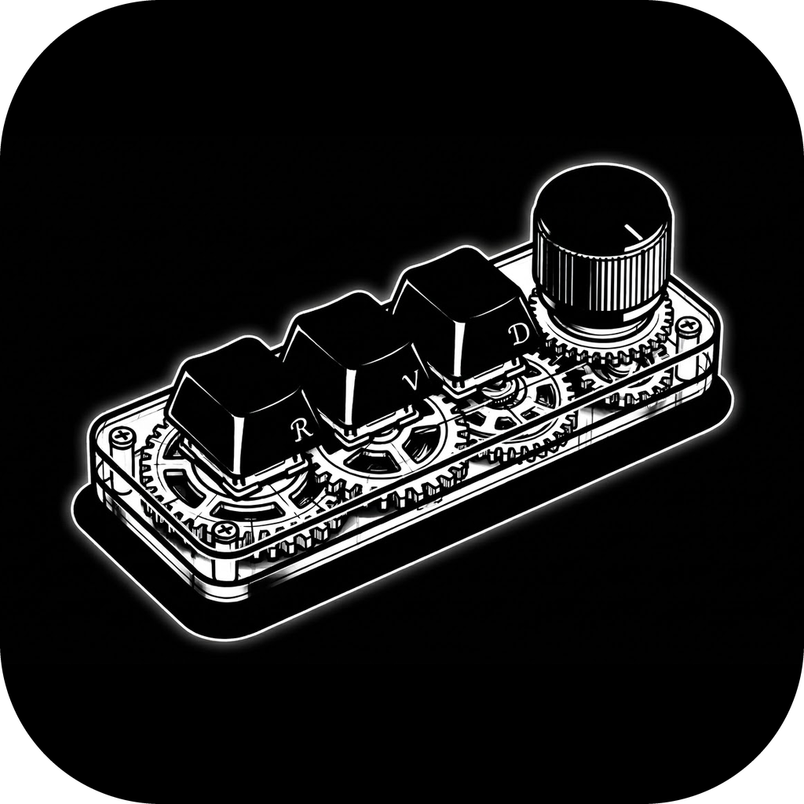

# RevienDocker · Diseño artístico

> Documento para revisión. Describe la dirección visual actual de la app y del icono; los puntos abiertos están al final.

## Concepto

Un macropad CH57x visto como **mecanismo de relojería**: teclas de cera negra, base translúcida con engranajes y tornillos. El lenguaje es **blanco y negro limpio sobre negro profundo**: sin color de acento, sin degradados de color, sin sombras de neón. El color solo aparece como estado (verde, ámbar, rojo) en píldoras y puntos.

## Icono

- Fuente: `assets/Icon_definitivo.jpg` (ilustración definitiva, fondo negro).
- `studio_icon.py` centra el dibujo sobre el mismo negro, así el fondo se funde y no queda marco. La esquina es suave (20 % del lado) y la máscara se dibuja con supersampleado para que el borde no tenga escalera de píxeles.
- Salidas: `assets/icon.png` (1024 px) y `assets/icon.ico` (16 a 256 px). Se regeneran con `python studio_icon.py`.
- `assets/icon.svg` ya no se usa; se puede borrar cuando lo confirmes.

## Logotipo

- `assets/wordmark.svg`: «REVIENDOCKER» en vector. Lo genera `python studio_wordmark.py` a partir de Doris PP instalada: las letras son trazos, no texto, así que se ve nítido a cualquier tamaño y no depende de la fuente instalada.
- En la cabecera van juntos el icono (26 px) y el wordmark (20 px de alto).

## Paleta

Todo son tokens en `:root` de `studio.css`:

| Token | Valor | Uso |
|---|---|---|
| `--bg` | `#08090c` | Fondo de la ventana |
| `--panel` | `#0f1218` | Paneles y barra de título |
| `--panel-2` / `--panel-3` | `#151a23` / `#1c2330` | Controles y hover |
| `--line` / `--line-2` | `#222a38` / `#323d52` | Bordes finos |
| `--text` / `--muted` | `#eef1f6` / `#8791a3` | Texto principal y secundario |
| `--accent` | `#ffffff` | Acciones primarias (blanco sobre negro) |
| `--green` / `--amber` / `--red` | `#4ade80` / `#fbbf24` / `#f87171` | Solo estados |

## Tipografía

Dos fuentes **instaladas en el sistema**:

- **Doris PP** (`--font-title`): «REVIENDOCKER» en mayúsculas, interletrado 0.06 em. En la app va como vector (`assets/wordmark.svg`), así que no depende de la fuente instalada.
- **Expressway** (`--font`, cae a Inter y Segoe UI): toda la interfaz.

Las fuentes no están embebidas en el ejecutable. En un PC sin ellas la app usa el sistema de respaldo.

## Título metálico

Degradado de **opacidades** en blanco (sin color), dentro del SVG:

- Degradado lineal con bandas de blanco pleno y blanco al 28–62 % para el efecto de metal pulido.
- Filete de 0,02 em al 30 % de blanco, que da el borde fino. Sin sombras ni desenfoques: el brillo es el propio degradado.

## Esquinas

Regla: **ninguna esquina llega a 90º ni queda pura (radio 0)**.

- Controles, paneles, teclas y píldoras: **4 px**; contenedores grandes (`--r`): **6 px**.
- Botones de ventana: **3 px** (antes 0).
- Perilla y puntos de estado: círculos (`50%`), que no tienen esquinas.
- Indicador de la perilla: 2 px, es una barra fina, no una caja.

## Movimiento

- Curva `cubic-bezier(0.23, 1, 0.32, 1)`.
- Solo se animan `transform` y `opacity` (color y borde en hover).
- Los estados de hover van dentro de `@media (hover: hover) and (pointer: fine)`.

## Para revisar

1. **Icono negro**: el icono es el dibujo sobre negro, sin marco blanco. En una barra de tareas clara se distingue bien; en una oscura se funde con el fondo. ¿Lo dejamos así?
2. **Fuentes**: el wordmark ya es vector (trazos de Doris PP), así que la licencia de Doris PP hay que confirmarla para ese uso. Expressway sigue sin embeberse en el ejecutable.
3. **Negrita de Expressway**: solo tengo la variante Rg; los pesos 600 y 700 se sintetizan y pueden verse borrosos.
4. **Radios**: 4 px en controles y 6 px en contenedores. ¿Te parece bien esa proporción?
5. **Título en mayúsculas** con el degradado: ¿lo prefieres en tipo mixto?
