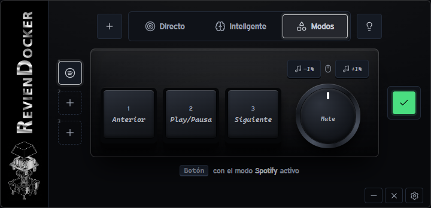

<h1 align="center">RevienDocker</h1>

<p align="center"><b>Tres teclas, una rueda y la acción justa en cada momento.</b></p>

<p align="center">
  Versión 0.1.6 · <a href="https://github.com/Revienkek/RevienDocker/releases/latest">Descargar <code>RevienDocker.exe</code></a> · <a href="CHANGELOG.md">Historial de cambios</a> · <a href="PRODUCT.md">Producto y estilo</a> · <a href="docs/GUIA_USUARIO.md">Guía de uso</a>
</p>



RevienDocker convierte un macropad de 3 teclas y 1 rueda (chip WCH CH57x) en un mando para tu PC. Lo configuras aquí; después trabaja solo.

## Qué te deja hacer

Hay tres formas de usarlo. Comparten pantalla y controles: lo que aprendes en una te sirve en las otras.

### Directo
*Una tecla, una acción, en cualquier programa.*

- Cada tecla escribe una letra, lanza una combinación (Ctrl+Shift+…), pausa la música o salta de canción.
- La rueda son tres botones: giro a la izquierda, giro a la derecha y pulsar. Para el volumen, el zoom o desplazarte por una página.
- Guarda perfiles con icono y cambia entre tres de ellos con un clic desde el lateral.

### Inteligente
*La misma tecla, distinta según la app que tengas delante.*

Mantén **Shift** (o Ctrl o Alt, a tu elección) y pulsa un botón: hace lo que hayas definido para esa aplicación. Sin la tecla, hace lo de Directo.

- En el navegador cambia de pestaña. En OBS, de escena, silencia el micro o inicia la grabación y el directo (con el WebSocket de OBS activado).
- En Spotify sube o baja solo el volumen de Spotify, sin tocar el resto del sonido.

### Modos
*Tres configuraciones a un atajo de distancia.*

Cámbialas con **Ctrl+Shift+1**, **2** o **3**; basta con que RevienDocker esté en la bandeja. Repite el atajo para volver a Directo. Un aviso en pantalla y un destello de la tecla te dicen en cuál estás.

- **Plantillas listas:** Spotify, Música y volumen, WoW, Navegación, Reuniones, Edición, Trabajo diario, OBS por atajos y Teclas fantasma (F13–F18, para asignarlas en cualquier otro programa).
- **Mis modos:** crea y guarda hasta tres propios, con nombre e icono. Usar una plantilla pone una copia: la cambias a tu gusto y la original no se toca.

En los tres: teclado, multimedia y desplazamiento del ratón; cada giro de la rueda por separado; volumen general o solo el de Spotify.

## Qué necesitas

- Windows 10 u 11.
- El macropad conectado por USB. Sin él, el programa funciona en modo simulador para probar la interfaz.
- RevienDocker abierto o en la bandeja para que el motor procese los controles.

## Cómo empezar

1. Conecta el macropad por USB y abre **RevienDocker**.
2. En los ajustes, pulsa el enchufe para detectar el teclado.
3. Elige **Directo**, **Inteligente** o **Modos**. Pulsa una tecla o un sentido de la rueda en pantalla y después la tecla que quieras asignarle.
4. Pulsa **Aplicar** para guardar los cambios en el macropad.

## Ventana

- La ventana tiene tamaño fijo: no se redimensiona ni se maximiza. Al abrirse aparece en la esquina inferior derecha, sobre la barra de tareas. Solo vive en la bandeja del sistema: minimizar la guarda ahí y no ocupa la barra de tareas.
- Abajo a la derecha están minimizar, cerrar y los ajustes (rueda dentada: estado del teclado y del motor, y buscar el teclado). No hay barra de título: la ventana se mueve arrastrando cualquier zona que no sea un botón o un campo, y con clic derecho en una de esas zonas vuelve a su esquina.

## Estructura del repositorio

```
src/     motor, servidor local y ventana de escritorio (Python)
web/     interfaz (index.html, studio.css, studio.js, iconos) y sus assets
docs/    guía de uso
tools/   compilación del .exe y generación de iconos
tests/   pruebas automáticas
```

## Guía completa

La guía paso a paso (modo Inteligente, capas por app, OBS, recetas de rueda y problemas conocidos) está en [docs/GUIA_USUARIO.md](docs/GUIA_USUARIO.md). El producto y el estilo oficial están en [PRODUCT.md](PRODUCT.md).

## Compilar el ejecutable

Solo si quieres generar tu propio `.exe`:

```bash
pip install -r requirements.txt -r requirements-dev.txt
powershell -ExecutionPolicy Bypass -File tools\build_exe.ps1
```

El resultado queda en `dist\RevienDocker.exe`.

Para ejecutarlo desde el código sin compilar:

```bash
pip install -r requirements.txt
python src/studio_app.py
```

## Datos y privacidad

- Con el `.exe`, tu configuración se guarda en `%APPDATA%\RevienDocker\studio.json`. Desde el código, en `studio.json` en la raíz del repositorio.
- El programa solo escucha en tu propio PC (`127.0.0.1`). Otras webs no pueden usarlo para pulsar teclas.

## Pruebas

```bash
python -m unittest discover -s tests -t . -v
```

Las pruebas no necesitan el teclado ni OBS.

## Estado

La configuración de teclado y la grabación de atajos están probadas con simulador y pruebas automáticas. El formato de escritura USB es el de ch57x-keyboard-tool para este chip. Los botones de ratón atrás/adelante y los modos de luz 0–3 no están confirmados en el teclado real.

## Licencia

Licencia MIT, ver [LICENSE](LICENSE). Los iconos de interfaz son de Lucide (licencia ISC). Los iconos de aplicaciones y marcas (WoW, Spotify, OBS, Adobe, Google, Microsoft Office y otras) son dibujos propios que las evocan, no sus logotipos oficiales; los nombres y marcas pertenecen a sus propietarios.
