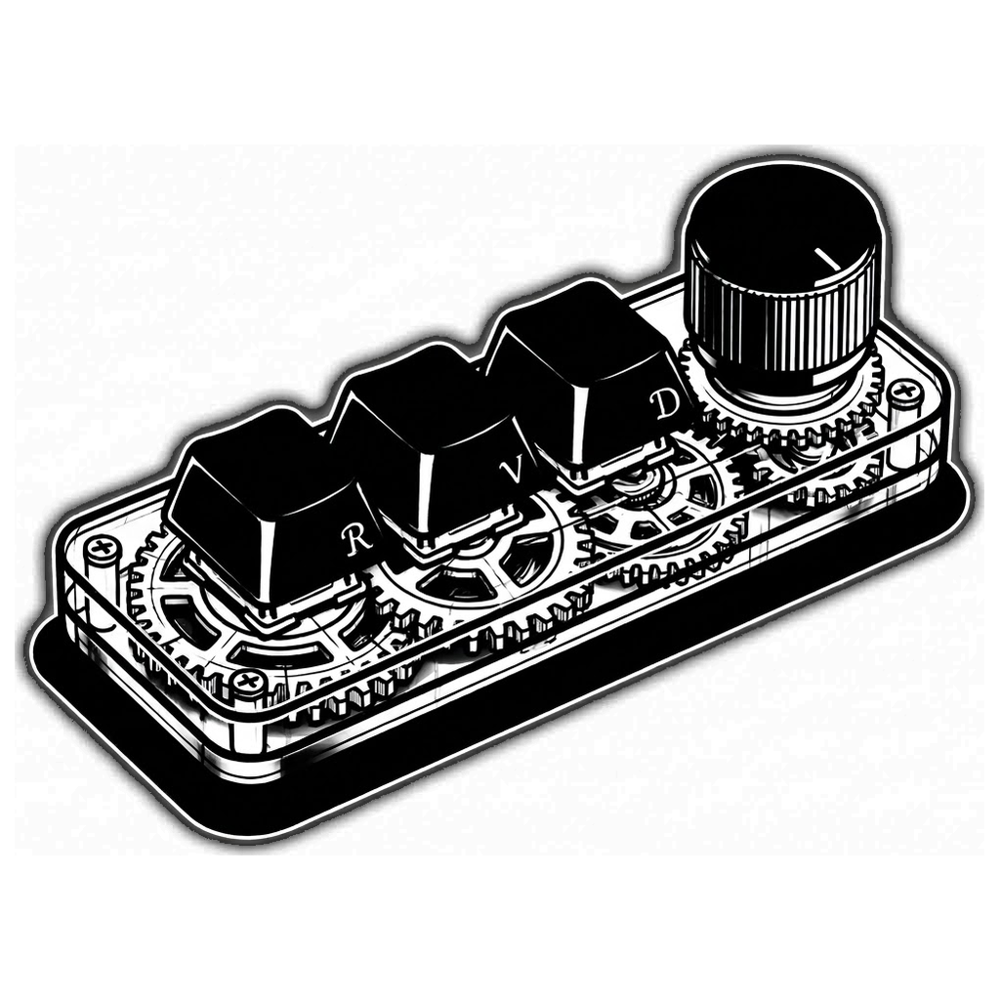

# RevienDocker

Programa de escritorio para Windows que configura el macropad de 3 teclas y 1 rueda (chip WCH CH57x) desde tu PC.



## Qué necesitas

- Windows 10 u 11.
- El macropad conectado por USB. Sin él, el programa funciona en modo simulador para probar la interfaz.
- Para el modo Inteligente: RevienDocker abierto (en la bandeja del reloj basta).

## Cómo empezar

1. Abre **RevienDocker** (el acceso directo del escritorio o `dist\RevienDocker.exe`).
2. Pulsa el enchufe de la cabecera para buscar el teclado. La píldora «Simulador» pasa a verde cuando lo detecta.
3. Elige un botón en el teclado (panel 1) y decide qué hace en el panel 2.
4. Pulsa **Aplicar cambios**. Eso escribe la configuración dentro del teclado.

Cuando el teclado tiene la configuración escrita, funciona solo, sin que el programa esté abierto.

## Los dos modos

- **Directo:** las asignaciones se guardan dentro del teclado y funcionan en cualquier PC. Para los pasos configurables del volumen de la rueda, RevienDocker debe estar abierto o en la bandeja de Windows.
- **Inteligente:** cada botón cambia según la app que tengas en primer plano (por ejemplo, otro atajo en OBS que en el navegador). Necesita RevienDocker en marcha; cerrar la ventana la oculta en la bandeja y el motor sigue activo.

Para elegir un modo, pulsa **Directo** o **Inteligente** en la cabecera.

## Ventana

- Arrastra cualquier borde o esquina para cambiar el tamaño (mínimo 720 × 560).
- Los botones de la esquina superior derecha minimizan, maximizan o cierran.

## Guía completa

La guía paso a paso (modo Inteligente, capas por app, OBS, recetas de rueda y problemas conocidos) está en [GUIA_USUARIO.md](GUIA_USUARIO.md). El diseño visual está en [DISEÑO.md](DISEÑO.md).

## Compilar el ejecutable

Solo si quieres generar tu propio `.exe`:

```bash
pip install -r requirements.txt -r requirements-dev.txt
powershell -ExecutionPolicy Bypass -File build_exe.ps1
```

El resultado queda en `dist\RevienDocker.exe`.

Para ejecutarlo desde el código sin compilar:

```bash
pip install -r requirements.txt
python studio_app.py
```

## Datos y privacidad

- Con el `.exe`, tu configuración se guarda en `%APPDATA%\RevienDocker\studio.json`. Desde el código, en `studio.json` junto a los archivos.
- El programa solo escucha en tu propio PC (`127.0.0.1`). Otras webs no pueden usarlo para pulsar teclas.

## Pruebas

```bash
python -m unittest discover -s tests -t . -v
```

Las pruebas no necesitan el teclado ni OBS.

## Estado

La configuración de teclado y la grabación de atajos están probadas con simulador y pruebas automáticas. El formato de escritura USB es el de ch57x-keyboard-tool para este chip. Los botones de ratón atrás/adelante y los modos de luz 0–3 no están confirmados en el teclado real.

## Licencia

Licencia MIT, ver [LICENSE](LICENSE). Los iconos de interfaz son de Lucide (licencia ISC).
