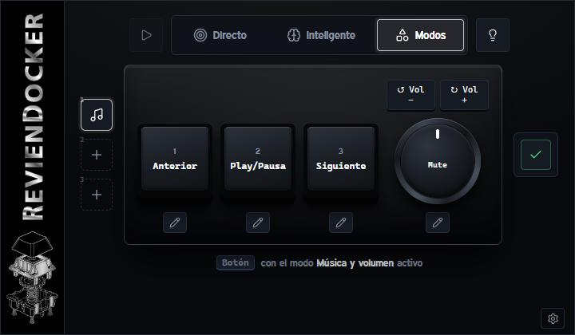

# RevienDocker

Programa de escritorio para Windows que configura el macropad de 3 teclas y 1 rueda (chip WCH CH57x) desde tu PC.

**Versión 0.0.82** · [Descargar `RevienDocker.exe`](https://github.com/Revienkek/RevienDocker/releases/latest) · [Historial de cambios](CHANGELOG.md) · [Producto y estilo](PRODUCT.md) · [Guía de uso](docs/GUIA_USUARIO.md)



## Qué necesitas

- Windows 10 u 11.
- El macropad conectado por USB. Sin él, el programa funciona en modo simulador para probar la interfaz.
- RevienDocker debe estar abierto o en la bandeja para que el motor procese los controles.

## Cómo empezar

1. Abre **RevienDocker** (el acceso directo del escritorio o `dist\RevienDocker.exe`).
2. Abre los ajustes (la rueda dentada, abajo a la derecha) y pulsa el enchufe para buscar el teclado. El punto del teclado pasa a verde cuando lo detecta.
3. Elige un botón en el teclado (panel 1) y decide qué hace en el panel 2.
4. Pulsa **Aplicar cambios**. Eso escribe la configuración dentro del teclado.

El teclado se prepara para comunicarse con el motor de RevienDocker, que ejecuta las acciones configuradas.

## Formas de uso

- **Directo:** asignaciones que se usan en cualquier aplicación; puedes guardarlas como perfiles.
- **Inteligente:** cada botón cambia según la app que tengas en primer plano (por ejemplo, otro atajo en OBS que en el navegador). Necesita RevienDocker en marcha; cerrar la ventana la oculta en la bandeja y el motor sigue activo.

- **Modos:** hasta tres configuraciones independientes. Se activan con **Ctrl+Shift+1/2/3** (repetirlo vuelve a Directo). Los menús de Directo, Inteligente y Modos se abren como capa superpuesta sobre el docker. A la izquierda del docker, un icono por hueco: pulsa uno para ver su menú (nombre, icono, plantilla, vaciar); un hueco vacío abre directamente las plantillas, en chips con icono y nombre. «Nuevo modo» es una plantilla más: eliges nombre e icono y empieza de cero. La vista previa de cada plantilla lleva un mini docker, y al cambiar de modo sale un aviso nativo abajo a la derecha, sobre la bandeja.
- **Misma estructura en los tres modos:** arriba, botón contextual + selector Directo / Inteligente / Modos + luz; debajo, iconos a la izquierda + docker + iconos a la derecha (✓ y ×); debajo, un mensaje informativo centrado. En Directo los tres huecos de la izquierda son marcadores; en Inteligente son la tecla de activación (Shift, Ctrl o Alt, una sola).

Elige el modo en el selector de arriba. El lápiz de cada control abre sus ajustes.

## Ventana

- La ventana tiene tamaño fijo: no se redimensiona ni se maximiza. Al abrirse aparece en la esquina inferior derecha, sobre la barra de tareas.
- Abajo a la derecha están minimizar, cerrar y los ajustes (rueda dentada: estado del teclado y del motor, y buscar el teclado). No hay barra de título: la ventana se mueve arrastrando cualquier zona que no sea un botón o un campo.

## Estructura del repositorio

```
src/     motor, servidor local y ventana de escritorio (Python)
web/     interfaz (index.html, studio.css, studio.js, iconos) y sus assets
docs/    guía de uso
tools/   compilación del .exe y generación de iconos
tests/   pruebas automáticas
```

## Guía completa

La guía paso a paso (modo Inteligente, capas por app, OBS, recetas de rueda y problemas conocidos) está en [docs/GUIA_USUARIO.md](docs/GUIA_USUARIO.md). El producto y el estilo oficial están en [PRODUCT.md](PRODUCT.md).

## Compilar el ejecutable

Solo si quieres generar tu propio `.exe`:

```bash
pip install -r requirements.txt -r requirements-dev.txt
powershell -ExecutionPolicy Bypass -File tools\build_exe.ps1
```

El resultado queda en `dist\RevienDocker.exe`.

Para ejecutarlo desde el código sin compilar:

```bash
pip install -r requirements.txt
python src/studio_app.py
```

## Datos y privacidad

- Con el `.exe`, tu configuración se guarda en `%APPDATA%\RevienDocker\studio.json`. Desde el código, en `studio.json` en la raíz del repositorio.
- El programa solo escucha en tu propio PC (`127.0.0.1`). Otras webs no pueden usarlo para pulsar teclas.

## Pruebas

```bash
python -m unittest discover -s tests -t . -v
```

Las pruebas no necesitan el teclado ni OBS.

## Estado

La configuración de teclado y la grabación de atajos están probadas con simulador y pruebas automáticas. El formato de escritura USB es el de ch57x-keyboard-tool para este chip. Los botones de ratón atrás/adelante y los modos de luz 0–3 no están confirmados en el teclado real.

## Licencia

Licencia MIT, ver [LICENSE](LICENSE). Los iconos de interfaz son de Lucide (licencia ISC).
